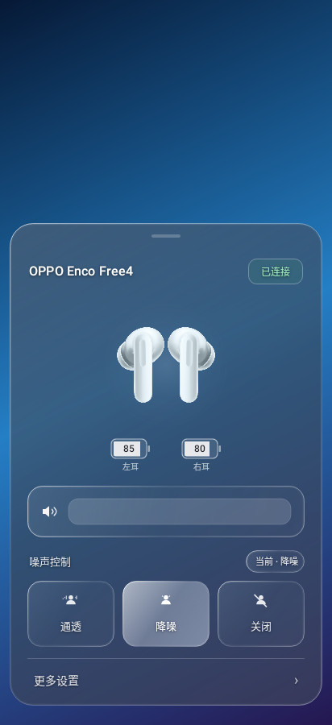
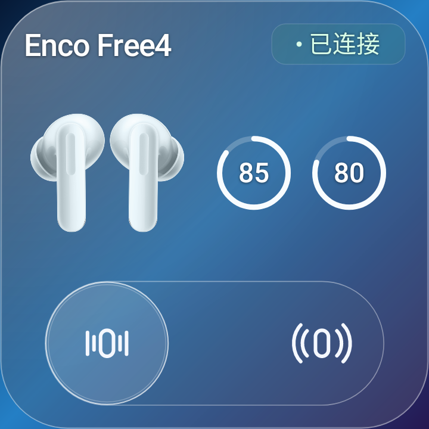

# Enco Free4 Control

无需 Root 的 **OPPO Enco Free4** Android 控制面板与桌面小部件。

An unofficial Android controller for OPPO Enco Free4: noise control, battery status, media volume and glass-style home screen widgets.

[下载 2.0.0 APK](https://github.com/uninner/EncoFree4-Control/releases/latest) · [更新记录](CHANGELOG.md) · [隐私说明](PRIVACY.md) · [协议笔记](docs/PROTOCOL.md)

## 功能

- 控制中心快捷设置磁贴：点按打开底部控制面板。
- 降噪、通透和关闭模式；收到耳机确认后更新选中状态。
- 左右耳电量；耳机均在盒内且协议返回数据时显示充电盒电量。
- 白色媒体音量条，与手机音量键同步。
- 2×2 / 2×1 固定尺寸玻璃小部件：连接状态、电量、降噪与通透切换。
- 240ms 滑块动画；具体流畅度取决于设备、系统与桌面启动器。
- 主面板采用局部轻磨砂；系统关闭模糊时自动加强底色，保持文字可读。
- 本地蓝牙通信，无账号、广告、统计 SDK 或网络权限。

## 预览

 


以上为程序渲染预览；实际玻璃效果、模糊与桌面占位由系统、壁纸和启动器共同决定。

## 安装与使用

要求 **Android 14 或更新版本**。目前面向 OPPO Enco Free4，其他耳机型号未验证。

1. 在 [Releases](https://github.com/uninner/EncoFree4-Control/releases) 下载 APK 并安装。
2. 在系统蓝牙设置中配对并连接耳机。
3. 下拉控制中心，编辑快捷设置磁贴，添加 **Enco Free4**。
4. 点按磁贴打开面板，并允许“附近的设备”权限。
5. 如需桌面控制，长按桌面进入小部件列表，添加 **Enco Free4 · 2×2** 或 **2×1**。

本应用通过快捷设置磁贴和小部件进入，没有独立的桌面启动图标。

点击主面板右上角状态标签不会切换连接；连接异常时可从底部“连接帮助”处理。小部件中，断开状态可点按重连；点按电量可刷新。

官方 Release 沿用固定签名，支持覆盖升级。自行编译的调试版使用不同签名，不能用于覆盖官方版。发布签名的 SHA-256 指纹：

```text
f8beea137cbe95daa6fa3844397f08c642e62ed3860a0fb460a6d86783db9b9c
```

小部件后台同步使用 Android 的 connected-device 前台服务。应用不申请通知权限；系统仍可能在“运行中应用”中显示其后台活动。不同系统的后台限制可能影响同步。

## 从源码编译

工具链：JDK 17、Android SDK 34、Build Tools 35.0.0；Gradle Wrapper 8.13，Android Gradle Plugin 8.7.3。

用 Android Studio 打开项目并配置 SDK；命令行也可通过 ANDROID_HOME 或未提交的 local.properties 指定 SDK。

```bash
# macOS / Linux
./gradlew :app:assembleDebug
./gradlew :app:testDebugUnitTest :app:lintDebug

# Windows PowerShell
.\gradlew.bat :app:assembleDebug
.\gradlew.bat :app:testDebugUnitTest :app:lintDebug
```

调试 APK 位于 app/build/outputs/apk/debug/app-debug.apk。未配置签名时，assembleRelease 生成未签名的 release APK。

项目保留了国内 Maven 镜像和官方仓库配置。首次构建需要下载 Android/Gradle/测试依赖；网络受限时请检查仓库可达性。

公开仓库和 CI 均不包含发布私钥。维护者在本机发布时，通过环境变量 ENCO_KEYSTORE、ENCO_STORE_PASSWORD、ENCO_KEY_PASSWORD、ENCO_KEY_ALIAS 提供原签名信息。

## 测试与贡献

2.0.0 在本地完成 24 组原生回归测试、lint 与 APK 签名核验。与 1.10.1 的 8 张渲染图比较完全一致。协议、连接生命周期和共享会话还提供独立测试，见 [tools/README.md](tools/README.md)。自动化测试不替代真实耳机与桌面测试。

欢迎提交 Issue 和 Pull Request。反馈连接或界面问题时，请注明手机型号、Android/系统版本、桌面启动器、耳机固件和复现步骤。请遮挡蓝牙地址、设备标识、通知与个人信息。

修改协议或连接逻辑时请补充测试；调整桌面布局前请同时检查两个规格的占位和点击区域。

## 许可证与声明

本项目为非官方社区工具，与 OPPO、HeyMelody、Xiaomi 等品牌无隶属或背书关系。

原创代码与文档采用 [MIT License](LICENSE)。第三方商标、设备图片与 Gradle Wrapper 等内容的许可范围见 [THIRD_PARTY_NOTICES.md](THIRD_PARTY_NOTICES.md)。
